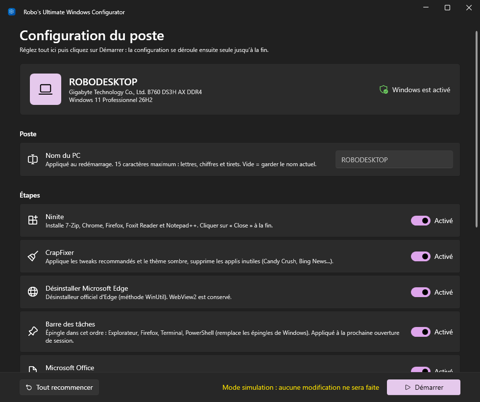
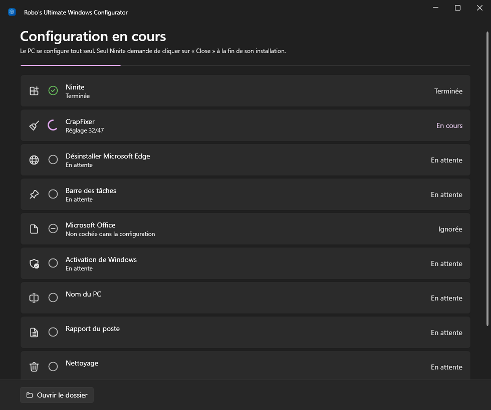

<div align="center">


# Robo's Ultimate Windows Configurator

**Un double-clic après l'installation de Windows 10 ou 11 : le PC se configure tout seul.**

[](https://github.com/Robocnop/Robo-s-Ultimate-Windows-configurator/releases/latest)


[Télécharger](https://github.com/Robocnop/Robo-s-Ultimate-Windows-configurator/releases/latest) ·
[Utilisation](#utilisation) ·
[Ce que fait l'application](#ce-que-fait-lapplication) ·
[Options](#options-en-ligne-de-commande) ·
[Après le passage](#recommandé-après-le-passage) ·
[Contribuer](CONTRIBUTING.md)

 [Read in English](README.md)

</div>

<table>
<tr>
<td width="40%">
<video src="https://github.com/user-attachments/assets/d62ebe6d-a8d7-4a0a-9620-bfb5e57f04e5" controls muted></video>
</td>
<td>

### En bref

- **Logiciels** : 7-Zip, Chrome, Firefox, Foxit Reader et Notepad++ via Ninite.
- **Nettoyage** : tweaks recommandés de CrapFixer, thème sombre, applis inutiles supprimées.
- **Edge** désinstallé proprement, WebView2 conservé.
- **Barre des tâches** rangée : Explorateur, Firefox, Terminal, PowerShell.
- **Office** installé et **Windows activé** (clé fournie ou clé OEM du BIOS).
- **Rapport du poste** sur le Bureau, renommage du PC, nettoyage et redémarrage.

Une seule application portable, sans rien à installer, avec une interface au style de Windows 11 :
thème clair ou sombre et couleur d'accent repris de Windows, effet Mica. Elle s'affiche en français sur un
Windows en français, en anglais sinon.

Interrompue ? Au lancement suivant, elle reprend là où elle s'était arrêtée.

</td>
</tr>
</table>

## Utilisation

1. [Télécharger `RoboConfigurator.exe`](https://github.com/Robocnop/Robo-s-Ultimate-Windows-configurator/releases/latest)
   et le copier sur le PC (clé USB, etc.).
2. Double-cliquer dessus et accepter la demande administrateur.
3. Régler la configuration, puis cliquer sur **Démarrer**.

Au démarrage, l'application affiche le poste (nom, modèle, version de Windows, activation) et permet de tout
régler : nouveau nom du PC, étapes à faire, tweaks CrapFixer (recommandés ou tous), clé Windows, redémarrage
et nettoyage à la fin. Si une clé Windows est enregistrée dans le BIOS, elle est signalée.

<table>
<tr>
<td width="50%"></td>
<td width="50%"></td>
</tr>
<tr>
<td align="center"><sub>Configuration du poste</sub></td>
<td align="center"><sub>Configuration en cours</sub></td>
</tr>
</table>

Une fois lancée, la configuration se déroule seule jusqu'à la fin : seul Ninite demande de cliquer sur
**Close**. Chaque étape affiche son avancement, et un journal détaillé est consultable dans l'application.

> [!TIP]
> Si l'application est interrompue, elle recharge la configuration au lancement suivant et passe les étapes
> déjà faites (marquées « Déjà faite »). Le bouton **Tout recommencer** oublie ce qui a été fait.

## Ce que fait l'application

| Étape | Ce qu'elle fait | Automatique ? |
|---|---|---|
| **Ninite** | Installe 7-Zip, Chrome, Firefox, Foxit Reader et Notepad++ | Oui, cliquer sur **Close** à la fin |
| **CrapFixer** | Applique les tweaks recommandés et le thème sombre, supprime les applis inutiles (Candy Crush, Skype, Bing News...) | Entièrement |
| **Edge** | Désinstalle Edge avec son désinstalleur officiel (même méthode que WinUtil), WebView2 conservé | Entièrement |
| **Barre des tâches** | Épingle, dans cet ordre : Explorateur, Firefox, Terminal, PowerShell (les épingles de Windows sont retirées). Appliqué à la prochaine ouverture de session | Entièrement |
| **Office** | Lance `OfficeSetup.exe` et attend la fin de l'installation | Entièrement |
| **Activation** | Si Windows n'est pas activé : installe la clé fournie, sinon la clé OEM enregistrée dans le BIOS (PC de marque) | Oui |

Pour CrapFixer, l'application lit directement ses fichiers `Wintweak2.ini` et `Winappx.ini` et applique les
entrées cochées par défaut dans l'appli. Mettre à jour l'archive CrapFixer sur le Nextcloud suffit donc pour
mettre à jour les tweaks.

### À la fin

- **Renommage du PC** si un nouveau nom a été choisi (appliqué au redémarrage).
- **Rapport du poste** `Rapport-<nom>-<date>.txt`, copié sur le Bureau : nom, modèle, n° de série, BIOS,
  Secure Boot, TPM, version et activation de Windows, processeur, mémoire, disques et espace libre, carte
  graphique, cartes réseau (MAC / IP) et résultat de chaque étape.
- **Nettoyage** (activé par défaut) : le dossier de travail `C:\RoboConfigurator` est supprimé. Il est conservé
  si une étape a échoué, pour pouvoir la reprendre.
- **Redémarrage** au bout de 60 secondes (activé par défaut), annulable ou avançable depuis l'application.

## Recommandé après le passage

Robo's Ultimate Windows Configurator fait ce dont toute installation neuve a besoin. Pour aller plus loin, ces
deux outils gratuits et open source valent le coup d'être lancés ensuite :

| Outil | Pourquoi |
|---|---|
| [**CrapFixer**](https://github.com/builtbybel/CrapFixer) | L'application n'applique que les tweaks *recommandés* de CrapFixer. Ouvrir CrapFixer lui-même permet de passer en revue tous les autres tweaks et applis, et de choisir ce qui convient à ce PC. |
| [**optimizerDuck**](https://github.com/itsfatduck/optimizerDuck) | Va plus loin sur les performances et la confidentialité : services, applis au démarrage, alimentation, télémétrie... |

> [!WARNING]
> Ne les télécharger que depuis leurs pages GitHub officielles ci-dessus, et créer un point de restauration
> avant d'appliquer un réglage dont on n'est pas sûr.

## Langue

L'application, son journal et le rapport du poste sont en **français** quand Windows est en français, en
**anglais** sinon. `-Lang fr` ou `-Lang en` force l'une ou l'autre.

## Options en ligne de commande

Les options pré-remplissent la configuration (depuis une invite de commandes ou un raccourci) :

```bat
RoboConfigurator.exe -Skip Office,Activation   :: désactiver des étapes (Ninite, CrapFixer, Edge, Taskbar, Office, Activation)
RoboConfigurator.exe -AllTweaks                :: sélectionner TOUS les tweaks CrapFixer, pas seulement les recommandés
RoboConfigurator.exe -WindowsKey XXXXX-XXXXX-XXXXX-XXXXX-XXXXX   :: clé Windows à installer si non activé
RoboConfigurator.exe -Lang en                  :: forcer la langue (en ou fr)
RoboConfigurator.exe -Reset                    :: oublier la configuration et les étapes faites, tout refaire
RoboConfigurator.exe -Simulation               :: parcourir l'application sans rien modifier sur le PC
```

## Compiler

```powershell
powershell -ExecutionPolicy Bypass -File build.ps1
```

Le script produit `dist\RoboConfigurator.exe`. Il utilise le SDK .NET installé, ou en installe une copie
locale dans `%USERPROFILE%\.dotnet` (sans droits administrateur) s'il n'y en a pas.

- Code source : `src\RoboConfigurator` (C# / WPF, interface [WPF-UI](https://github.com/lepoco/wpfui),
  dépendances intégrées dans l'exe par [Costura](https://github.com/Fody/Costura)).
- Les liens de téléchargement sont en haut de `src\RoboConfigurator\Core\Payloads.cs`.
- Pour un exe qui fonctionne **sans Internet**, déposer les fichiers dans `payloads\` avant de compiler
  (voir [payloads/README.md](payloads/README.md)).
- La version Debug ne demande pas les droits administrateur : pratique pour tester l'interface avec
  `-Simulation`.

## Contribuer

Signalements de bugs, idées et pull requests sont les bienvenus, en français ou en anglais. Voir
[CONTRIBUTING.md](CONTRIBUTING.md) (en anglais), qui contient aussi le code de conduite.

## Bon à savoir

- **Prérequis** : rien à installer. L'application utilise le .NET Framework 4.7.2+ fourni avec Windows 10
  (1803 et plus récents) et Windows 11 ; toutes les bibliothèques sont intégrées dans l'exe.
- **Session** : les réglages utilisateur (thème sombre, barre des tâches...) s'appliquent au compte qui lance
  l'application. La lancer depuis la session qui sera utilisée.
- **Fichiers** : tout est téléchargé dans `C:\RoboConfigurator`, avec un journal dans `journal.txt`. La
  configuration y est enregistrée dans `configuration.json` (clé Windows comprise) pour pouvoir reprendre.
- **Ancienne version** : le script PowerShell (`Configurator.ps1` + `Lancer.bat`) reste disponible dans la
  [v1.3.0](https://github.com/Robocnop/Robo-s-Ultimate-Windows-configurator/releases/tag/v1.3.0).
