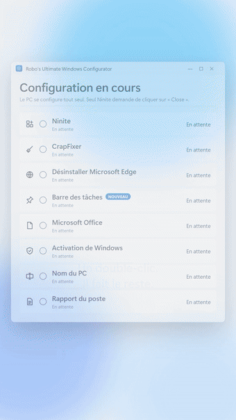
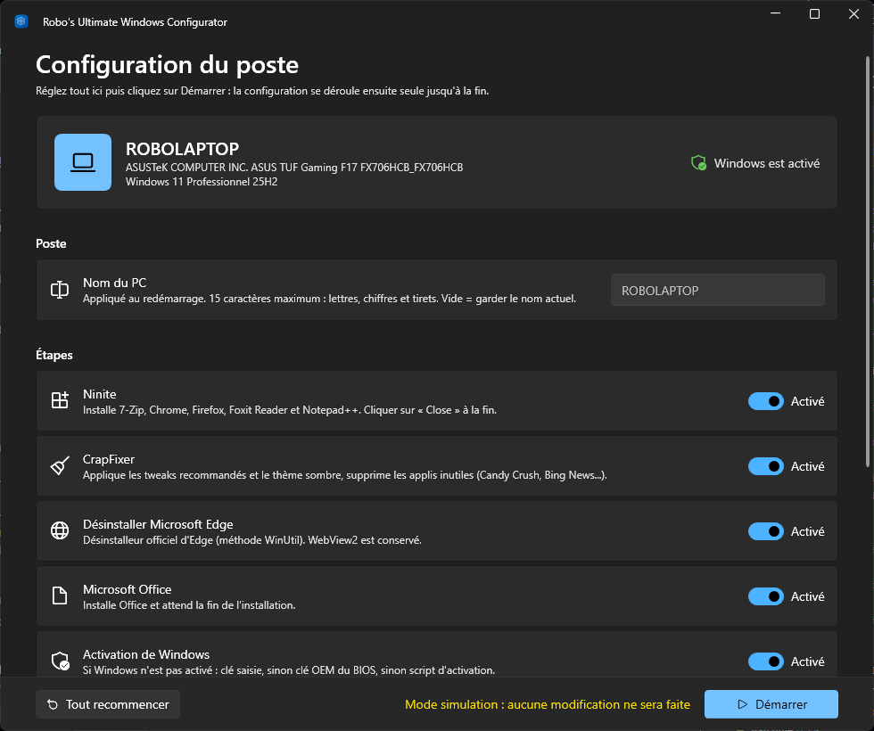
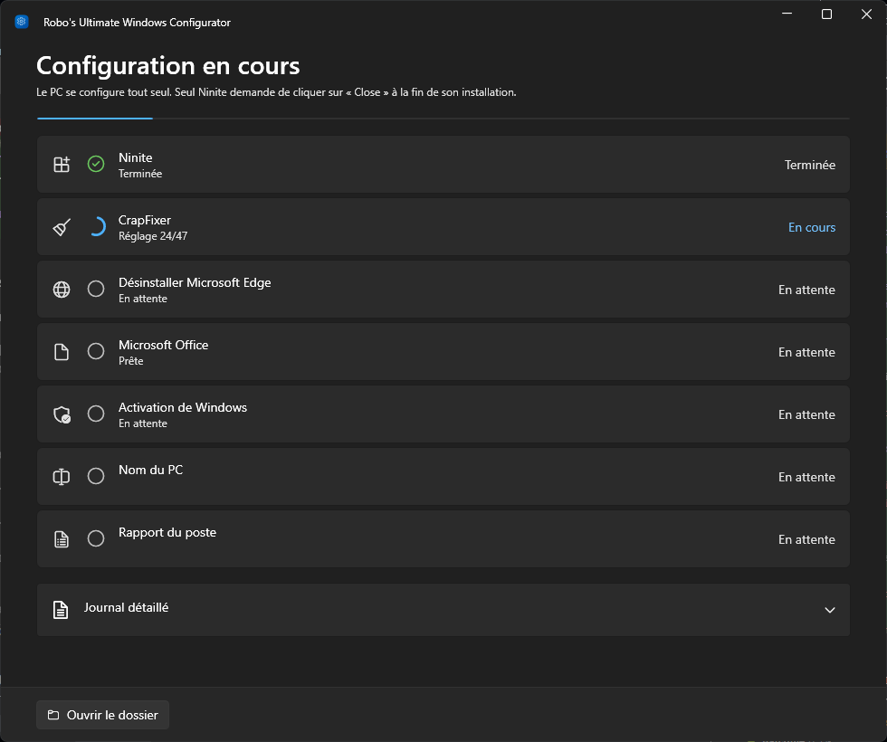

# Robo-s-Ultimate-Windows-configurator

Configuration automatique d'un PC juste après l'installation de Windows 10 ou 11.

Une seule application portable, `RoboConfigurator.exe`, avec une interface au style de Windows 11 :
thème clair ou sombre et couleur d'accent repris de Windows, effet Mica, cartes et interrupteurs comme dans
les Paramètres.

<p align="center">
  <a href="brag-output/brag.mp4"></a><br>
  <sub><a href="brag-output/brag.mp4">Voir la vidéo complète (24 s, avec le son)</a></sub>
</p>



## Utilisation

1. Copier `RoboConfigurator.exe` sur le PC (clé USB, etc.).
2. Double-cliquer dessus et accepter la demande administrateur.
3. Régler la configuration, puis cliquer sur **Démarrer**.

Rien d'autre à installer : l'application utilise le .NET Framework 4.7.2+ fourni avec Windows 10 (1803 et
plus récents) et Windows 11. Toutes les bibliothèques sont intégrées dans l'exe.

Au démarrage, l'application affiche le poste (nom, modèle, version de Windows, activation) et permet de tout
régler : nouveau nom du PC, étapes à faire, tweaks CrapFixer (recommandés ou tous), clé Windows et
redémarrage à la fin. Si une clé Windows est enregistrée dans le BIOS, elle est signalée.

Une fois lancée, la configuration se déroule seule jusqu'à la fin (seul Ninite demande de cliquer sur
**Close**). Chaque étape affiche son avancement, et un journal détaillé est consultable dans l'application.



Si l'application est interrompue, elle recharge la configuration au lancement suivant et passe les étapes
déjà faites (marquées « Déjà faite »). Le bouton **Tout recommencer** oublie ce qui a été fait.

## Ce que fait l'application

| Étape | Outil | Automatique ? |
|---|---|---|
| Ninite | Installe 7-Zip, Chrome, Firefox, Foxit Reader, Notepad++ | Oui, cliquer sur **Close** à la fin |
| CrapFixer | Applique les tweaks recommandés + thème sombre, supprime les applis inutiles (Candy Crush, Skype, Bing News...) | Entièrement |
| Edge | Désinstalle Edge avec son désinstalleur officiel (même méthode que WinUtil), WebView2 conservé | Entièrement |
| Barre des tâches | Épingle, dans cet ordre : Explorateur, Firefox, Terminal, PowerShell (les épingles de Windows sont retirées). Appliqué à la prochaine ouverture de session | Entièrement |
| Office | Lance `OfficeSetup.exe` et attend la fin de l'installation | Entièrement |
| Activation | Si Windows n'est pas activé : installe la clé fournie, sinon la clé OEM enregistrée dans le BIOS (PC de marque) | Oui |

À la fin, l'application :
- **renomme le PC** si un nouveau nom a été choisi (appliqué au redémarrage) ;
- génère un **rapport du poste** `Rapport-<nom>-<date>.txt`, copié sur le Bureau et dans `C:\RoboConfigurator` :
  nom, modèle, n° de série, BIOS, Secure Boot, TPM, version et activation de Windows, processeur, mémoire,
  disques et espace libre, carte graphique, cartes réseau (MAC / IP) et résultat de chaque étape ;
- **redémarre** au bout de 60 secondes si c'est activé. Le redémarrage peut être annulé ou avancé depuis
  l'application.

Pour CrapFixer, l'application lit directement ses fichiers `Wintweak2.ini` et `Winappx.ini` et applique les
entrées cochées par défaut dans l'appli. Mettre à jour l'archive CrapFixer sur le Nextcloud suffit donc
pour mettre à jour les tweaks.

Tout est téléchargé dans `C:\RoboConfigurator`, avec un journal dans `journal.txt`.

## Options

Les options pré-remplissent la configuration (à passer depuis une invite de commandes ou un raccourci) :

```bat
RoboConfigurator.exe -Skip Office,Activation   :: désactiver des étapes (Ninite, CrapFixer, Edge, Office, Activation)
RoboConfigurator.exe -AllTweaks                :: sélectionner TOUS les tweaks CrapFixer, pas seulement les recommandés
RoboConfigurator.exe -WindowsKey XXXXX-XXXXX-XXXXX-XXXXX-XXXXX   :: clé Windows à installer si non activé
RoboConfigurator.exe -Reset                    :: oublier la configuration et les étapes faites, tout refaire
RoboConfigurator.exe -Simulation               :: parcourir l'application sans rien modifier sur le PC
```

## Compiler l'application

```powershell
powershell -ExecutionPolicy Bypass -File build.ps1
```

Le script produit `dist\RoboConfigurator.exe`. Il utilise le SDK .NET installé, ou en installe une copie
locale dans `%USERPROFILE%\.dotnet` (sans droits administrateur) s'il n'y en a pas.

- Code source : `src\RoboConfigurator` (C# / WPF, interface [WPF-UI](https://github.com/lepoco/wpfui),
  dépendances intégrées dans l'exe par [Costura](https://github.com/Fody/Costura)).
- Les liens de téléchargement sont en haut de `src\RoboConfigurator\Core\Payloads.cs`.
- Pour un exe qui fonctionne **sans Internet**, déposer les fichiers dans `payloads\` avant de compiler
  (voir [payloads/README.md](payloads/README.md)).
- La version Debug ne demande pas les droits administrateur : pratique pour tester l'interface avec
  `-Simulation`.

## Remarques

- Les réglages utilisateur (thème sombre, barre des tâches...) s'appliquent au compte qui lance
  l'application : la lancer depuis la session qui sera utilisée.
- La configuration est enregistrée dans `C:\RoboConfigurator\configuration.json` (clé Windows comprise) et
  supprimée automatiquement quand toutes les étapes ont réussi.
- L'ancienne version en script PowerShell (`Configurator.ps1` + `Lancer.bat`) reste disponible dans la
  [v1.3.0](https://github.com/Robocnop/Robo-s-Ultimate-Windows-configurator/releases/tag/v1.3.0).
