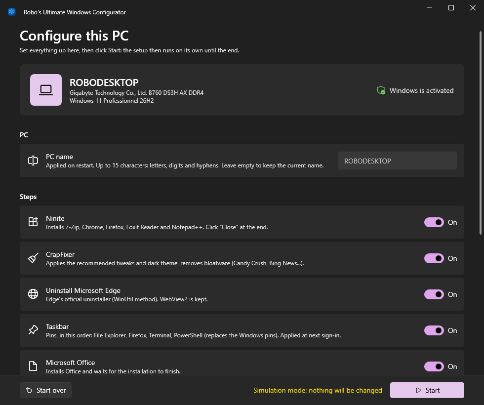
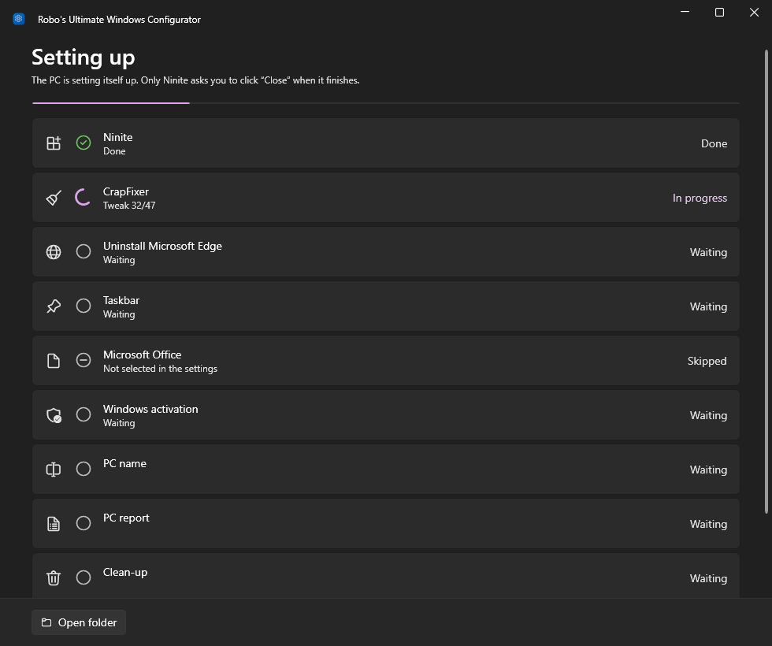

<div align="center">


# Robo's Ultimate Windows Configurator

**One double-click after installing Windows 10 or 11, and the PC sets itself up.**

[](https://github.com/Robocnop/Robo-s-Ultimate-Windows-configurator/releases/latest)


[](LICENSE)

[Download](https://github.com/Robocnop/Robo-s-Ultimate-Windows-configurator/releases/latest) ·
[Usage](#usage) ·
[What it does](#what-it-does) ·
[Options](#command-line-options) ·
[After the run](#recommended-after-the-run) ·
[Contributing](CONTRIBUTING.md)

 [Lire en français](README.fr.md)

</div>

<table>
<tr>
<td width="40%">
<video src="https://github.com/user-attachments/assets/3113d242-ca74-4676-a539-d62cf75943c2" controls muted></video>
</td>
<td>

### At a glance

- **Software**: 7-Zip, Chrome, Firefox, Foxit Reader and Notepad++ through Ninite.
- **Clean-up**: CrapFixer's recommended tweaks, dark theme, bloatware removed.
- **Edge** cleanly uninstalled, WebView2 kept.
- **Taskbar** sorted: File Explorer, Firefox, Terminal, PowerShell.
- **Office** installed and **Windows activated** (key provided or the BIOS OEM key).
- **PC report** on the desktop, PC renaming, clean-up and restart.

A single portable app with nothing to install and a Windows 11 look: light or dark theme and accent
colour taken from Windows, Mica effect. It speaks English, or French on a French Windows.

Interrupted? On the next launch it picks up right where it left off.

</td>
</tr>
</table>

## Usage

1. [Download `RoboConfigurator.exe`](https://github.com/Robocnop/Robo-s-Ultimate-Windows-configurator/releases/latest)
   and copy it to the PC (USB stick, etc.).
2. Double-click it and accept the administrator prompt.
3. Adjust the settings, then click **Start**.

On launch, the app shows the PC (name, model, Windows version, activation) and lets you set everything up:
new PC name, steps to run, CrapFixer tweaks (recommended or all), Windows key, restart and clean-up at the
end. If a Windows key is stored in the BIOS, it is pointed out.

<table>
<tr>
<td width="50%"></td>
<td width="50%"></td>
</tr>
<tr>
<td align="center"><sub>Configure this PC</sub></td>
<td align="center"><sub>Setting up</sub></td>
</tr>
</table>

Once started, the setup runs on its own until the end: only Ninite asks you to click **Close**. Each step
shows its progress, and a detailed log is available in the app.

> [!TIP]
> If the app is interrupted, it reloads the settings on the next launch and skips the steps already done
> (marked “Already done”). The **Start over** button forgets what was done.

## What it does

| Step | What it does | Automatic? |
|---|---|---|
| **Ninite** | Installs 7-Zip, Chrome, Firefox, Foxit Reader and Notepad++ | Yes, click **Close** at the end |
| **CrapFixer** | Applies the recommended tweaks and dark theme, removes bloatware (Candy Crush, Skype, Bing News...) | Fully |
| **Edge** | Uninstalls Edge with its official uninstaller (same method as WinUtil), WebView2 kept | Fully |
| **Taskbar** | Pins, in this order: File Explorer, Firefox, Terminal, PowerShell (the Windows pins are removed). Applied right away to the current session (previous pins are backed up), and for every account at sign-in | Fully |
| **Office** | Runs `OfficeSetup.exe` and waits for the installation to finish | Fully |
| **Activation** | Optionally switches Windows Home to Pro first (restart, then run the app again). If Windows is not activated: installs the key provided, otherwise the OEM key stored in the BIOS (branded PCs) | Yes |

For CrapFixer, the app reads its `Wintweak2.ini` and `Winappx.ini` files directly and applies the entries
that are selected by default in CrapFixer. Updating the CrapFixer archive on the Nextcloud is therefore
enough to update the tweaks.

### When it's done

- **PC renaming** if a new name was chosen (applied on restart).
- **PC report** `Report-<name>-<date>.txt`, copied to the desktop: name, model, serial number, BIOS, Secure
  Boot, TPM, Windows version and activation, processor, memory, disks and free space, graphics card,
  network adapters (MAC / IP) and the result of each step.
- **Clean-up** (on by default): the working folder `C:\RoboConfigurator` is deleted. It is kept if a step
  failed, so it can be resumed, unless **Clean up even if a step fails** is on (a copy of the log then stays on
  the desktop).
- **Restart** after 60 seconds (on by default), which can be cancelled or brought forward from the app.

## Recommended after the run

Robo's Ultimate Windows Configurator covers what every fresh install needs. To go further, these two free,
open-source tools are worth running afterwards:

| Tool | Author | Why |
|---|---|---|
| [**CrapFixer**](https://github.com/builtbybel/CrapFixer) | [@Belim](https://github.com/Belim) ([builtbybel](https://github.com/builtbybel)) | The app applies CrapFixer's *recommended* tweaks only. Open CrapFixer itself to review every other tweak and app, and pick what suits this PC. |
| [**optimizerDuck**](https://github.com/itsfatduck/optimizerDuck) | [@itsfatduck](https://github.com/itsfatduck) | Goes further on performance and privacy: services, startup apps, power settings, telemetry... |

> [!WARNING]
> Download them only from their official GitHub pages above, and create a restore point before applying
> anything you are unsure about.

## Language

The app, its log and the PC report are in **English**, or in **French** when Windows is in French. Use
`-Lang en` or `-Lang fr` to force one or the other.

## Command-line options

The options pre-fill the settings (from a command prompt or a shortcut):

```bat
RoboConfigurator.exe -Skip Office,Activation   :: turn steps off (Ninite, CrapFixer, Edge, Taskbar, Office, Activation)
RoboConfigurator.exe -AllTweaks                :: select ALL CrapFixer tweaks, not just the recommended ones
RoboConfigurator.exe -WindowsKey XXXXX-XXXXX-XXXXX-XXXXX-XXXXX   :: Windows key to install if not activated
RoboConfigurator.exe -Lang fr                  :: force the language (en or fr)
RoboConfigurator.exe -Edition Pro              :: Windows edition wanted for activation (Pro or Home)
RoboConfigurator.exe -ForceCleanUp             :: clean up the working folder even if a step fails
RoboConfigurator.exe -Reset                    :: forget the settings and completed steps, redo everything
RoboConfigurator.exe -Simulation               :: walk through the app without changing anything on the PC
```

## Build

```powershell
powershell -ExecutionPolicy Bypass -File build.ps1
```

The script produces `dist\RoboConfigurator.exe`. It uses the installed .NET SDK, or installs a local copy in
`%USERPROFILE%\.dotnet` (no administrator rights needed) if there is none.

- Source code: `src\RoboConfigurator` (C# / WPF, [WPF-UI](https://github.com/lepoco/wpfui) interface,
  dependencies embedded in the exe with [Costura](https://github.com/Fody/Costura)).
- Download links are at the top of `src\RoboConfigurator\Core\Payloads.cs`.
- For an exe that works **offline**, put the files in `payloads\` before building
  (see [payloads/README.md](payloads/README.md)).
- The Debug build does not ask for administrator rights: handy for testing the interface with `-Simulation`.

## Contributing

Bug reports, ideas and pull requests are welcome, in English or French. See [CONTRIBUTING.md](CONTRIBUTING.md)
and the [code of conduct](CODE_OF_CONDUCT.md).

## License

Robo's Ultimate Windows Configurator is free software, released under the [GNU General Public License v3.0](LICENSE).
You can use, study, share and modify it; modified versions you distribute must stay under the same licence and
come with their source code.

## Good to know

- **Requirements**: nothing to install. The app uses the .NET Framework 4.7.2+ that ships with Windows 10
  (1803 and later) and Windows 11; all libraries are embedded in the exe.
- **Session**: user settings (dark theme, taskbar...) apply to the account that runs the app. Run it from
  the session that will be used.
- **Files**: everything is downloaded to `C:\RoboConfigurator`, with a detailed log in `log.txt`
  (product keys are masked). The settings are
  saved there in `configuration.json` (Windows key included) so the run can be resumed.
- **Previous version**: the PowerShell script (`Configurator.ps1` + `Lancer.bat`, French only) is still
  available in [v1.3.0](https://github.com/Robocnop/Robo-s-Ultimate-Windows-configurator/releases/tag/v1.3.0).
